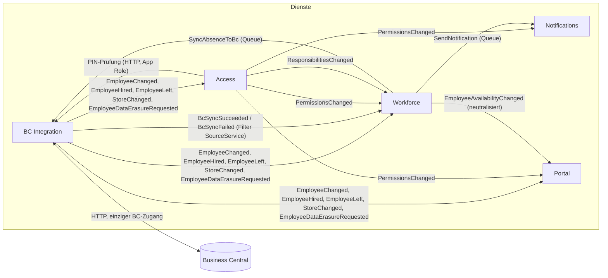

# Architektur und Entwicklung

Stand: 2026-10-23. Regeln und Entscheidungen: `CLAUDE.md`; Plan: `Umsetzungsplan Mitarbeiterportal – Backend-Architektur.md`.

## Dienste und Nachrichten



Der Weg einer Krankmeldung: Workforce-API → Zustand + Outbox in **einer** DB-Transaktion (`SyncAbsenceToBc`, `EmployeeAvailabilityChanged`, `SendNotification`) → Service Bus → BC Integration (Upsert über die interne GUID als externe ID) → `BcSyncSucceeded`/`BcSyncFailed` → Workforce setzt den Sync-Status; Notifications legt die InApp-Benachrichtigung der Filialleitung ab. Der Grund der Abwesenheit steht nur im Command an BC Integration, nie in Events oder Push-fähigen Daten.

Die Topologie (Topics, Queues, Subscriptions mit Zweck-Kommentar, Filter, Rollenzuweisungen) steht in `infra/servicebus.bicep`; der lokale Emulator nutzt dieselbe Topologie (`infra/servicebus-emulator.json`). `tests/Architecture.Tests/ServiceBusTopologyTests.cs` vergleicht beide, den Nachrichtenkatalog und die in den Diensten registrierten Subscriptions. Emulator-Besonderheit: maximale Lebensdauer 1 h (Azure: 1 Tag).

## Lokal starten

Voraussetzungen: .NET SDK 10, Docker.

```bash
make test                         # build + alle Tests (inkl. E2E, unter 5 Minuten)
dotnet run --project src/AppHost  # ganze Landschaft starten, Aspire-Dashboard im Browser
```

Der AppHost startet PostgreSQL (eine Datenbank je Dienst), den Service-Bus-Emulator, WireMock als BC-Ersatz (`tests/Fixtures/Bc/e2e-landscape`: eine Filiale, sechs Mitarbeitende, PIN 4711 für alle) und die fünf Dienste.

Lokal ersetzt ein statisches Fake-Token die Entra-Dienst-Tokens (`LocalServiceAuth=true`, nur Development/Testing); die anderen Dienste prüfen Personen-Tokens gegen Access. Erster Administrator ist Personalnummer `10099` (`Access:BootstrapAdministrators`). Anmelden: `POST /api/auth/login` mit `{"personnelNumber":"10099","pin":"4711"}`.

Tests: Unit/Integration/Vertrag/Architektur laufen mit `dotnet test`; E2E (`tests/AppHost.Tests`, Kategorie `E2E`) startet die ganze Landschaft über Aspire. BC-Sandbox-Tests (`Category=BcSandbox`) nur manuell.

## Neuen Konsumenten hinzufügen

1. Nachricht ist im Katalog (`CLAUDE.md`) und der Konsument dort als erlaubt eingetragen (sonst erst Rückfrage).
2. Handler in `<Dienst>.Infrastructure` (`IMessageHandler<T>`, idempotent) und `AddMessageHandler<TContext, T, THandler>(MessageSource.Subscription(MessagingNames.For(typeof(T)), "<dienst>"))` in `InfrastructureServiceCollectionExtensions`.
3. Subscription in `infra/servicebus.bicep` ergänzen (Zweck-Kommentar, ggf. Filter, Rolle) und `infra/servicebus-emulator.json` gleich halten; der Topologie-Test sagt, was fehlt.
4. Kopien personenbezogener Daten: Löschung in `EmployeeDataErasureRequested`-Handler und Integrationstest.

## Neue Nachricht hinzufügen

Nur nach Rückfrage. Dann: `sealed record` in `<Dienst>.Contracts` mit `[Sensitivity(...)]` und XML-Doku, Eintrag in `tests/Architecture.Tests/ContractRulesTests.cs` (Katalogliste), Verify-Snapshot-Test, Topic/Queue + Subscriptions in der Topologie (siehe oben), Eintrag im Katalog in `CLAUDE.md`. Events sind höchstens `SensitiveNeutralized`; Klasse 3 nie.

## Neuen Endpunkt hinzufügen

Recht im Katalog des Dienstes (`<Dienst>Privileges`, wird beim Start bei Access angemeldet), Policy `AppPolicies.Privilege(...)` bzw. `AppPolicies.ServiceRole(...)` (eigene App Role, siehe `docs/entra-setup.md`), mindestens ein positiver und ein negativer Berechtigungstest.

## Entra

Einrichtungspaket für den Tenant-Admin: `docs/entra-setup.md`, Skripte unter `infra/entra/` (werden vom Projekt nicht ausgeführt).
