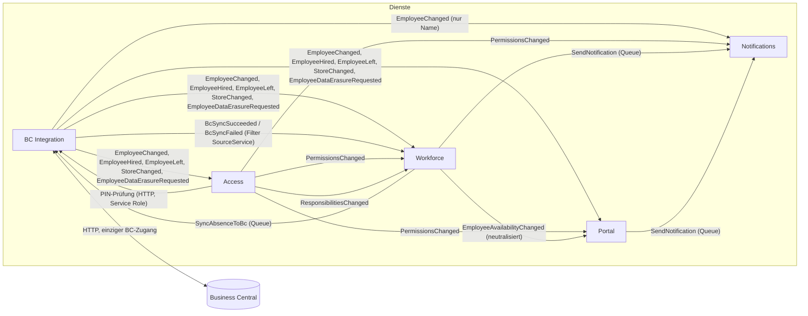

# Architektur und Entwicklung

Überarbeitet 2026-11-10. Regeln und Entscheidungen: `CLAUDE.md`; Zielbild und Leitplanken: `Umsetzungsplan Mitarbeiterportal – Backend-Architektur.md`. Lokal starten und Fehlersuche: `know-how.md`.

## Dienste und Nachrichten

**Weg einer Krankmeldung:** Workforce-API → Zustand und Outbox in **einer** DB-Transaktion (`SyncAbsenceToBc`, `EmployeeAvailabilityChanged`, `SendNotification`) → Service Bus → BC Integration (Upsert über die interne GUID als externe ID) → `BcSyncSucceeded`/`BcSyncFailed` → Workforce setzt den Sync-Status, Notifications legt die InApp-Benachrichtigung ab. Der Grund der Abwesenheit steht nur im Command an BC Integration, nie in Events oder Push-fähigen Daten.

**Topologie** (Topics, Queues, Subscriptions mit Zweck-Kommentar, Filter, Rollen): `infra/servicebus.bicep`; der lokale Emulator nutzt dieselbe (`infra/servicebus-emulator.json`). `tests/Architecture.Tests/ServiceBusTopologyTests.cs` vergleicht beide, den Nachrichtenkatalog und die in den Diensten registrierten Subscriptions. Emulator: Lebensdauer höchstens 1 Stunde (Azure: 1 Tag).

## Lokal starten und testen

`cd src/AppHost && dotnet run` startet Postgres, Service-Bus-Emulator, WireMock als BC-Ersatz und die fünf Dienste, danach `cd Frontend && npm start`. Anleitung, Testnutzer, Ports und Fehlersuche: `know-how.md`, `mock-login.md`.

Tests: `dotnet test NewWorld.slnx` (Unit, Integration, Vertrag, Architektur, End-to-End); BC-Sandbox-Tests (`Category=BcSandbox`) nur manuell. Frontend: `npx ng test --watch=false` in `Frontend/`.

## Erweitern

**Neuer Konsument:** (1) Die Nachricht ist im Katalog und der Konsument dort erlaubt (sonst erst Rückfrage). (2) Handler in `<Dienst>.Infrastructure` (`IMessageHandler<T>`, idempotent) und `AddMessageHandler<TContext, T, THandler>(MessageSource.Subscription(MessagingNames.For(typeof(T)), "<dienst>"))`. (3) Subscription in `infra/servicebus.bicep` und im Emulator ergänzen; der Topologie-Test sagt, was fehlt. (4) Bei Kopien personenbezogener Daten: Löschung im `EmployeeDataErasureRequested`-Handler samt Integrationstest.

**Neue Nachricht (nur nach Rückfrage):** `sealed record` in `<Dienst>.Contracts` mit `[Sensitivity(...)]` und XML-Doku, Eintrag in `tests/Architecture.Tests/ContractRulesTests.cs`, Verify-Snapshot, Topic/Queue samt Subscriptions in der Topologie, Eintrag im Katalog in `CLAUDE.md`. Events sind höchstens `SensitiveNeutralized`, Klasse 3 nie.

**Neuer Endpunkt:** Recht im Katalog des Dienstes (`<Dienst>Privileges`, mit Beschreibung; wird beim Start bei Access angemeldet), Policy `AppPolicies.Privilege(...)` oder `AppPolicies.ServiceRole(...)` (wer die Service Role hat, steht in `ServiceAuth:Peers` des Empfängers), mindestens ein positiver und ein negativer Berechtigungstest, Recht in `docs/rollen.json` aufnehmen, wenn eine Rolle es braucht.

## Weitere Dokumente

| Thema | Datei |
| --- | --- |
| Dienst-zu-Dienst-Authentifizierung | `service-auth.md` |
| Krankmeldung und AU | `krankmeldung-au.md` |
| Abwesenheiten, Urlaubsberechnung | `phase-6-workforce-abwesenheiten.md`, `urlaubsberechnung.md` |
| Mitarbeiterkarte, Nicht-Verfügbarkeit, Arbeitszeitkonto | `mitarbeiterkarte.md` |
| Benachrichtigungstexte | `benachrichtigungstexte.md` |
| Portal (FAQ, Meldungen, Statistik) | `portal.md` |
| Zweiter Faktor mit Entra | `zweiter-faktor-entra.md` |
| BC-Zeiterfassung | `bc-zeiterfassung-schnittstelle.md` |
| Rollen als Datei | `rollen.json` |
